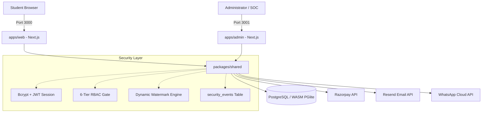

# Hritikpedia — System Architecture & Engineering Blueprint

> **Official Tagline:** Stop Searching. Start Learning.  
> **Brand Identity:** Midnight Navy (`#07172B`), Electric Blue (`#087BFF`), Golden Accent (`#FFB923`), Light Background (`#F5F8FC`).  
> **Absolute Scope Discipline:** Educational Notes, Chapters, Articles, and Learning Blueprints exclusively. **NO Test Series or Quizzes.**

---

## 1. Executive Architecture Overview

Hritikpedia is architected as a high-performance, zero-budget-first educational notes platform built on Node.js ESM, Next.js 16 (App Router + Turbopack), React 19, Tailwind CSS v4, and standard relational PostgreSQL.

### Key Architectural Pillars:
1. **Physical Isolation of Surfaces**: The public student-facing website (`apps/web` on port 3000) and the internal operations console (`apps/admin` on port 3001) are separate Next.js applications sharing a single typed shared logic package (`@hritikpedia/shared`). The admin portal is never linked in public navigation, footers, or sitemaps.
2. **Zero-Budget-First Database Engine**: Transparently executes on genuine PostgreSQL whether deployed to cloud serverless PostgreSQL (Neon/RDS) or running locally via embedded WebAssembly PostgreSQL (`@electric-sql/pglite`) storing data in `./.pgdata`.
3. **In-Browser Secure Document Reader**: High-security HTML5 canvas-based PDF rendering with server-side dynamic watermarking, anti-copying, print blocking, and zero direct public download links.
4. **Idempotent Commerce Pipeline**: Server-side price calculation, constant-time HMAC-SHA256 signature verification, and webhook replay protection for Razorpay payments.
5. **Multi-Channel Compliant Communications**: Transactional email, SMS, and WhatsApp adapters governed by strict opt-in discipline and off-by-default safe toggles.

---

## 2. Monorepo Structure

```
HritikPedia/
├── apps/
│   ├── web/                     # Public student portal (Port 3000)
│   │   ├── public/              # Brand vectors, logo.png, logo.svg
│   │   └── src/
│   │       ├── app/             # Next.js App Router (Landing, Catalog, Reader, Auth, Dashboard)
│   │       │   ├── api/         # Checkout, Webhooks, In-Browser Reader, Student API
│   │       │   ├── notes/       # Multi-filter catalog & note detail pages
│   │       │   ├── reader/      # In-browser protected PDF viewer
│   │       │   ├── checkout/    # Razorpay payment & coupon interface
│   │       │   └── dashboard/   # Student notes library & order history
│   │       └── components/      # BrandLogo, Header, Footer, AdSlot, NoteCard
│   │
│   └── admin/                   # Staff Operations & SOC Console (Port 3001)
│       └── src/
│           ├── app/             # Overview, Notes CMS, Users & RBAC, Orders & Refunds,
│           │                    # PDF Policies & Watermarks, Advertising, Newsletter, SOC Logs
│           │   ├── api/admin/   # Protected administrative REST APIs
│           │   └── login/       # Staff isolated sign-in portal
│           └── components/      # AdminShell, AdminSidebar, AdminHeader, BrandLogo
│
├── packages/
│   └── shared/                  # Core shared domain logic
│       └── src/
│           ├── brand.js         # Color tokens, typography, official tagline
│           ├── permissions.js   # 6-tier RBAC capability matrix
│           ├── auth.js          # Bcryptjs 12-round hashing, HS256 JWT tokens
│           ├── db.js            # Unified PostgreSQL & WASM PGlite client
│           ├── validation.js    # DTO validators, URL slug engine, HTML sanitizer
│           ├── watermark.js     # Dynamic watermark coordinate & SVG pattern engine
│           ├── payment.js       # Razorpay order creator & constant-time HMAC validator
│           ├── audit.js         # Security event recorder & sliding-window rate limiter
│           ├── ads.js           # Google AdSense tag & direct sponsor validator
│           ├── messaging.js     # Email, SMS & WhatsApp multi-channel adapters
│           └── data.js          # Production educational curriculum data
│
├── database/
│   ├── migrations/              # 17 Normalized PostgreSQL DDL tables & indexes
│   │   ├── 001_initial_schema.sql
│   │   └── 002_indexes_and_views.sql
│   ├── seeds/                   # Initial production subjects, notes, and articles
│   └── migrate.js               # Cross-platform migration and seed runner
│
├── scripts/
│   ├── dev.js                   # Concurrent launcher for apps/web & apps/admin
│   └── test-runner.js           # 42-point automated verification test suite
│
└── docs/                        # Complete technical & security documentation
```

---

## 3. Data Flow Diagram



---

## 4. In-Browser Document Protection Architecture

To ensure zero leakage of paid educational notes while maintaining ₹0 storage costs:
1. **Server-Side Authorization**: The reader endpoint (`/api/reader/[slug]`) verifies the student's JWT session cookie. If the note is free, access is allowed. If paid, it queries `entitlements(user_id, note_id, status='active')`. If unauthorized, only the preview pages (e.g., first 5 pages) are returned.
2. **Dynamic Watermarking**: The server generates diagonal repeating watermark metadata containing the student's masked email (`hr***ar@gmail.com`), unique learner UID (`UID: 1042`), UTC timestamp, and anti-distribution disclaimer.
3. **Canvas-Based Rendering**: Notes are rendered onto an HTML5 `<canvas>` element inside a sandbox. Right-click context menus (`contextmenu`), text selection (`selectstart`), drag-and-drop, and printing shortcuts (`Ctrl+P`, `Meta+P`) are actively intercepted and suppressed.
4. **Forensic Traceability**: If a user photographs their screen, the semi-transparent diagonal watermark across the canvas uniquely identifies the student account and IP address.
